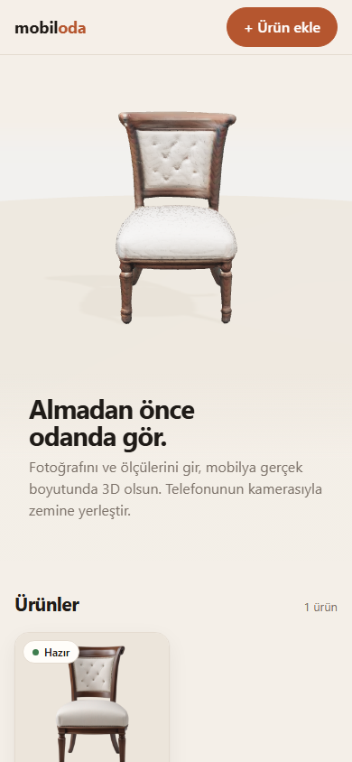
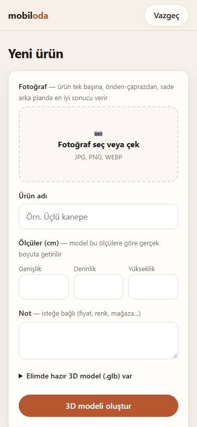
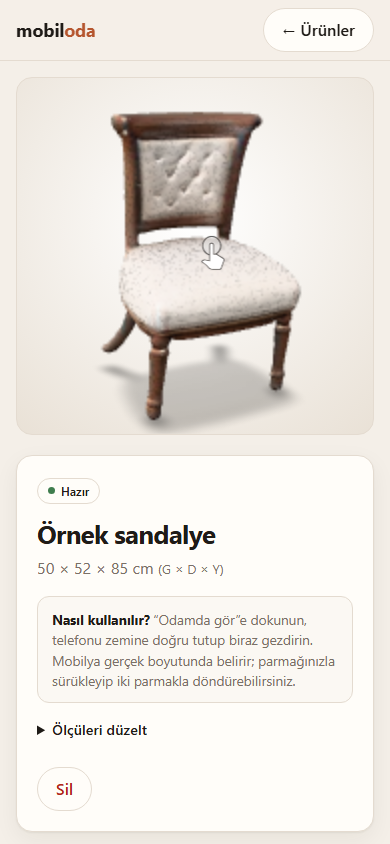
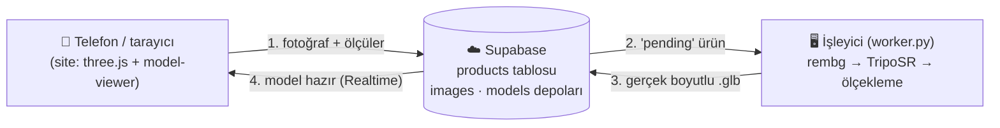

<div align="center">

# mobil<span>oda</span>

**Almadan önce odanda gör.**
Mobilyanın fotoğrafını ve ölçülerini gir. Fotoğraftan gerçek boyutlu bir 3D model üretilsin, telefonunun kamerasıyla odanda zemine yerleştir.


 &nbsp;
 &nbsp;


</div>

---

## Özellikler

- **Fotoğraftan 3D model:** [TripoSR](https://github.com/VAST-AI-Research/TripoSR) ile tek bir fotoğraftan dokulu 3D model üretilir. Model ücretsiz ve açık kaynaklıdır, kendi bilgisayarınızda çalışır. API ücreti ya da kullanım limiti yoktur.
- **Gerçek ölçü:** Model girilen genişlik × derinlik × yükseklik (cm) değerlerine göre ölçeklenir ve zemine oturtulur.
- **Odamda gör (AR):** iPhone'da AR Quick Look, Android'de Scene Viewer veya WebXR kullanılır. Mobilya sabit, gerçek boyutta yerleşir.
- **3D vitrin:** Ana sayfada ürünler three.js ile dönen bir podyumda sergilenir.
- **Hazır model desteği:** Üretici `.glb` veriyorsa doğrudan yüklenebilir. Bu durumda yalnızca ölçekleme yapılır.
- **Canlı durum:** Model üretimi ilerledikçe sayfa Supabase Realtime ile kendiliğinden güncellenir.
- **Ölçü düzeltme:** Ölçüler sonradan değiştirilirse model yeniden üretilmeden tekrar ölçeklenir.

## Nasıl çalışır



1. Site fotoğrafı `images` deposuna yükler ve ürünü `pending` durumunda `products` tablosuna ekler.
2. Bilgisayarınızda çalışan işleyici bekleyen ürünü alır, arka planı siler ve TripoSR ile 3D modeli üretir. Ardından dokuyu pişirir. iPhone Quick Look köşe renklerini göstermediği için bu adım gereklidir.
3. Model ölçülere göre ölçeklenir ve `models` deposuna yüklenir. Ürün `ready` olur.
4. Sayfa güncellenir, **Odamda gör** butonu belirir.

Model üretimi Supabase'de değil sizin bilgisayarınızda yapılır, çünkü TripoSR ekran kartı gerektirir.

## Gereksinimler

| | |
|---|---|
| İşletim sistemi | Windows 10/11. Linux'ta `setup.ps1` adımlarını elle uygulayın. |
| Ekran kartı | NVIDIA, en az 4 GB VRAM. RTX 3050 Ti 4 GB ile denendi, model başına yaklaşık 2 dakika sürüyor. |
| Yazılım | [Node.js 20+](https://nodejs.org), [Python 3.11](https://www.python.org), [Git](https://git-scm.com) |
| Disk | Yaklaşık 6 GB (PyTorch ve TripoSR modeli) |
| Hesap | Ücretsiz bir [Supabase](https://supabase.com) projesi |

## Kurulum

### 1. Projeyi indirin

```bash
git clone https://github.com/ozanacarr/mobiloda.git
cd mobiloda
npm install
```

### 2. Supabase

1. [supabase.com](https://supabase.com) üzerinde yeni bir proje açın.
2. **SQL Editor**'de [`supabase/schema.sql`](supabase/schema.sql) dosyasının içeriğini yapıştırıp **Run**'a basın. Bu, tabloyu, depoları ve erişim kurallarını oluşturur.
3. `.env.example` dosyasını `.env` adıyla kopyalayın. **Project Settings → API** bölümündeki proje URL'sini ve **publishable** anahtarı (`sb_publishable_...`) içine yazın.

> Yalnızca herkese açık **publishable** anahtarı kullanın. `service_role` ya da `sb_secret_` anahtarını ve veritabanı şifrenizi bu projeye koymayın.

### 3. 3D işleyici (TripoSR)

```powershell
powershell -ExecutionPolicy Bypass -File worker\setup.ps1
```

Betik şunları yapar:
- `worker/.venv` içinde bir sanal ortam oluşturur.
- TripoSR'ı indirir ve Windows uyumluluk yamasını ([`worker/triposr.patch`](worker/triposr.patch)) uygular. Yama, derleme gerektiren `torchmcubes` yerine `PyMCubes` kullanır.
- PyTorch'u (CUDA 12.1) ve diğer paketleri kurar.

TripoSR modeli (yaklaşık 1,7 GB) ilk çalıştırmada otomatik iner.

### 4. Çalıştırma

`baslat.bat` dosyasına çift tıklayın. Biri site, biri işleyici için iki pencere açılır. Elle başlatmak için:

```bash
npm start                                    # site → http://localhost:3000
worker\.venv\Scripts\python worker\worker.py # 3D işleyici
```

### 5. Telefondan açma

Sunucu açılırken `Telefondan: http://192.168.x.x:3000` adresini yazar. Telefon ve bilgisayar aynı Wi-Fi'da olmalıdır.

Windows bağlantıyı engellerse ağı **Özel** yapıp 3000 numaralı bağlantı noktasına izin verin. Bunun için PowerShell'i yönetici olarak açın:

```powershell
New-NetFirewallRule -DisplayName "Mobiloda 3000" -Direction Inbound -Protocol TCP -LocalPort 3000 -Action Allow -Profile Private
```

iPhone'da **Safari** kullanın.

## Proje yapısı

```
├── public/              # Site (derleme adımı yok)
│   ├── index.html       # 3D vitrin + ürün listesi (three.js)
│   ├── add.html         # Ürün ekleme formu
│   ├── product.html     # 3D görüntüleyici + Odamda gör (model-viewer)
│   ├── app.js           # Supabase istemcisi ve ortak işlevler
│   └── style.css
├── server.js            # Statik sunucu, /config.js ile Supabase ayarlarını verir
├── supabase/schema.sql  # Tablo, depolar ve RLS kuralları
├── worker/
│   ├── worker.py        # Kuyruğu dinler: TripoSR → doku → ölçekleme → yükleme
│   ├── setup.ps1        # İşleyici kurulumu
│   ├── triposr.patch    # TripoSR için Windows/GPU düzeltmeleri
│   └── requirements.txt
└── baslat.bat           # Site + işleyiciyi birlikte başlatır
```

## İyi sonuç için ipuçları

- Ürün fotoğrafta **tek başına** ve **tamamen görünür** olsun.
- **Sade arka plan** ve **önden ya da hafif çaprazdan** çekim en iyi sonucu verir. Arka plan otomatik silinir.
- Üreticinin sitesindeki stüdyo fotoğrafları genelde idealdir.
- TripoSR tek fotoğraftan çalışır, bu yüzden ürünün görünmeyen arka yüzünü tahmin eder. Hazır bir `.glb` varsa onu tercih edin.

## Güvenlik notu

Projede giriş sistemi yoktur. RLS kuralları publishable anahtarla okuma ve yazmaya izin verir, yani site adresini bilen herkes ürün ekleyip silebilir. Bu, ev ağında kişisel kullanım için tasarlandı. İnternete açmadan önce [Supabase Auth](https://supabase.com/docs/guides/auth) ekleyip `schema.sql` içindeki kuralları `authenticated` kullanıcılarla sınırlayın.

## Teşekkürler

- [TripoSR](https://github.com/VAST-AI-Research/TripoSR): Stability AI ve Tripo AI (MIT)
- [model-viewer](https://modelviewer.dev): Google
- [three.js](https://threejs.org), [rembg](https://github.com/danielgatis/rembg), [trimesh](https://trimesh.org), [Supabase](https://supabase.com)

## Lisans

[MIT](LICENSE)
